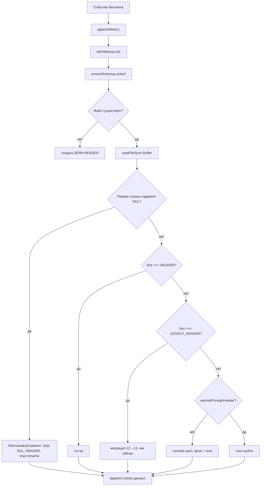

# Design: 013 — Ремонт history-файла с NUL-повреждением и молчаливое восстановление схемы

> Requirements: @requirements.md
> Status: Draft
> Last Updated: 2026-10-24

## 1. Executive Summary

Ремонт реализуется целиком внутри `ensureSchemaLocked()` в `src/history.ts`. Отдельный repair-скрипт НЕ создаётся: разовый ремонт существующего 7-МБ файла (FR-001) выполняет сам механизм FR-002 — после деплоя первый же `appendHistory` вызовет `ensureSchemaLocked` (под history-lock), который молча срежет NUL-блок и восстановит заголовок (tmp + renameSync).

Ключевые изменения: (1) чтение файла на детект-этапе переключается со строки на Buffer, чтобы детект NUL был байтовым; (2) ветка «первая строка содержит `\x00`» выполняет молчаливый ремонт; (3) ветка иностранного заголовка без NUL сохраняется, но warning дедуплицируется флагом уровня модуля — не чаще 1 раза на процесс.

## 2. Requirements Mapping

| Requirement | Design Coverage | Notes |
|-------------|-----------------|-------|
| FR-001 | §4, TD-001 | Выполняется FR-002 при первом append после деплоя — отдельный скрипт не нужен |
| FR-002 | §4, TD-001, TD-002 | Молчаливый ремонт внутри ensureSchemaLocked |
| FR-003 | §4, TD-003 | Warning ≤1 раза на процесс, флаг под lock |
| FR-004 | §4, TD-001 | tmp + renameSync под lock, никогда не бросает, идемпотентен |
| NFR-001 | §4 | Strip префикса + одна запись tmp, без построчного разбора |
| NFR-002 | §4, TD-001 | finally-unlink tmp, политика passive observer |
| NFR-003 | §4 | Ремонт молчит; допускается один info-уровень лога (опционально) |

## 3. System Architecture

### Component Overview

| Component | Responsibility | Boundaries | Notes |
|-----------|----------------|------------|-------|
| `ensureSchemaLocked()` (src/history.ts) | Детект NUL-повреждения, молчаливый ремонт, warn-once для чужого заголовка | Вызывается только под history-lock, только из appendHistory | Существующая функция, меняется тело |
| `appendHistory()` | Точка входа ремонта при первом событии после повреждения | Без изменений | Вызывает ensureSchemaLocked под lock |
| `trimHistory()` | Без изменений | — | NUL-повреждение к моменту trim уже устранено (repair идёт раньше при первом append) |

### Data / Control Flow



## 4. Implementation Design

### Component / Module Structure

```text
src/history.ts
  ensureSchemaLocked()   -- модифицируется (детект + ремонт + warn-once)
  (вспомогат.) repairNulPrefixLocked(buf) -- приватная функция ремонта
tests/history.test.mts  -- расширяется новыми кейсами
```

Отдельный repair-скрипт/CLI не создаётся (решение зафиксировано в requirements D-001/D-002: FR-001 выполняется FR-002).

### Core Interfaces

Публичный API (`appendHistory`, `trimHistory`, `setPaths`, `resetPaths`, `csvEscape`, `isoLocal`, `RETENTION_DAYS`) не меняется. Новые приватные сущности:

```ts
/** Warning про чужой заголовок — не чаще 1 раза на процесс (FR-003). */
let warnedForeignHeader = false;

/**
 * Молчаливый ремонт NUL-повреждённого файла. Caller держит lock.
 * buf -- содержимое файла как Buffer. Никогда не бросает наружу:
 * сбой = console.warn + return (passive observer).
 */
function repairNulPrefixLocked(buf: Buffer): void;
```

### Алгоритм ремонта (FR-001 / FR-002)

1. **Детект (байтовый, не строковый).** `const buf = fs.readFileSync(historyFile)` — читать Buffer, а не `readFileSync(..., "utf8")`. Найти индекс первого `\n` в буфере (граница первой строки); если в срезе `buf[0..firstNewline]` есть байт `0x00` (или первая строка отсутствует, но `buf[0] === 0`) → повреждение. Обоснование байтового детекта: `readFileSync("utf8")` превращает NUL в символы `\x00` в строке — детект возможен и на строке, но Buffer надёжнее (нет зависимости от декодирования 5.8 МБ мусора) и быстрее (не декодируем NUL-блок вовсе).
2. **Strip.** Найти offset первого ненулевого байта (`offset = 0; while (offset < buf.length && buf[offset] === 0) offset++`). Байты `[0, offset)` — NUL-блок, отбрасываются.
3. **Остаток.** `rest = buf.subarray(offset).toString("utf8")`. Убрать ведущий `\uFEFF` у остатка, если он есть (BOM старого файла мог уцелеть перед первой строкой данных — маловероятно, но безвредно срезать).
4. **Первая строка остатка.** Если первая строка остатка всё ещё содержит `\x00` (патологический случай: NUL внутри не-ведущего блока заголовка) — строка уничтожена, отбросить её тоже (данные после первого `\n` сохранить).
5. **EOL.** Определить по содержимому остатка: `rest.includes("\r\n") ? "\r\n" : "\n"` — тот же способ, что текущая LEGACY-миграция (Q-001).
6. **Запись.** `tmp = historyFile + ".tmp." + process.pid`; `fs.writeFileSync(tmp, "\uFEFF" + HEADER + eol + rest, "utf8")`; `fs.renameSync(tmp, historyFile)`; в `finally` — `unlinkSync(tmp)` с игнорированием ошибки (тот же паттерн, что существующая миграция).
7. **Отказ.** Весь ремонт — внутри try/catch ветки `ensureSchemaLocked`-уровня: сбой = `console.warn("...NUL repair failed...")` + return без записи (файл не трогаем, passive observer).
8. **После ремонта** ветка return: текущий append просто допишет строку к уже починенному файлу.

### Порядок веток в ensureSchemaLocked (итоговый)

```text
файл отсутствует → создать BOM+HEADER (как сейчас)
read Buffer
первая строка содержит 0x00 → repairNulPrefixLocked(); return   (FR-002, молча)
first (после BOM) === HEADER → return                            (идемпотентно)
first === LEGACY_HEADER → существующая миграция                  (без изменений)
иначе → !warnedForeignHeader && console.warn(...); warnedForeignHeader = true
```

Важно: чтение строки `first` после байтового детекта — из декодированного буфера (`buf.toString("utf8")` один раз, переиспользуется и для детекта, и для LEGACY/foreign-веток), чтобы не читать файл дважды. Если NUL не обнаружен, поведение полностью идентично текущему коду.

### Data Model / State

Не применимо: формат CSV, набор колонок, HEADER/LEGACY_HEADER не меняются. Единственное новое состояние — модульный флаг `warnedForeignHeader` (время жизни = процесс).

### API / Integration Contract

Не применимо: публичный API не меняется; контракт `appendHistory` (никогда не бросает, `boolean`) сохраняется.

## 5. Integration Points

| System | Purpose | Auth / Permissions | Failure Handling |
|--------|---------|--------------------|------------------|
| history-lock (proper-lockfile) | Сериализация ремонта между процессами pi | существующий | как сейчас |
| NTFS rename | Атомарная подмена файла | — | сбой rename → tmp удалён в finally, старый файл нетронут |
| console | Единственный warning: ремонт не логирует; сбой ремонта и чужой заголовок (1 раз) — warn | — | — |

## 6. Security / Permissions / Privacy

- **Authentication/Authorization:** не применимо (локальный файл, права процесса).
- **Input validation:** повреждённый файл трактуется строго как «NUL в первой строке» — ложное срабатывание на валидном UTF-8 CSV невозможно (NUL не валиден в UTF-8 CSV, Q-002).
- **Sensitive data:** данные истории не логируются; warning не содержит содержимого файла.
- **Abuse cases:** не применимо.

## 7. UX / Accessibility

Не применимо (CLI-модуль). Пользовательское наблюдение: исчезновение повторяющегося warning в окнах pi.

## 8. Edge Cases

| Case | Expected Behavior |
|------|-------------------|
| Файл целиком из NUL (остатка нет) | Ремонт пишет только BOM+HEADER+EOL; файл валиден, далее append работает |
| NUL внутри первой строки после не-NUL байтов | Строка уничтожена → отбрасывается (п.4 алгоритма), данные после неё сохраняются |
| BOM уцелел между NUL-блоком и данными | Срезается; новый файл начинается со свежего BOM+HEADER |
| Починенный файл / файл с актуальным заголовком | no-op (идемпотентность FR-004) |
| rename fails (например, файл read-only) | warn + файл не тронут, tmp удалён (тот же тест-паттерн, что migration-fail в существующих тестах) |
| Чужой заголовок без NUL | Файл не трогаем, append поверх сохраняется, warning ≤1 раза на процесс |
| Два конкурирующих append при чужом заголовке | Оба идут под lock, флаг-проверка тоже под lock → ровно один warning |
| CRLF-повреждённый файл | EOL по остатку → CRLF сохраняется |

## 9. Impact Analysis

| Component | Impact Type | Description and Risk | Required Action |
|-----------|-------------|----------------------|-----------------|
| src/history.ts (ensureSchemaLocked) | modified | Байтовый детект + ветка ремонта + warn-once. Риск: регрессия существующих веток (create/HEADER/LEGACY/foreign) | Тесты: все существующие кейсы должны пройти без изменений |
| tests/history.test.mts | modified | Новые кейсы NUL-repair и warn-once | См. §11 |
| appendHistory / trimHistory / конкаренси-паттерн | none | Не меняются | — |

## 10. Development Sequencing

1. Байтовое чтение + детект NUL в `ensureSchemaLocked` — без изменения поведения остальных веток (существующие тесты зелёные).
2. `repairNulPrefixLocked` — молчаливый ремонт (strip, EOL, tmp+rename).
3. Флаг `warnedForeignHeader` для ветки иностранного заголовка.
4. Расширение `tests/history.test.mts`, полный прогон.

## 11. Testing / Verification Strategy

### Unit / Component (tests/history.test.mts, новые кейсы)

- Файл = 5.8-МБ-эквивалент ведущих `\x00` + валидные строки данных (LF) → первый `appendHistory` возвращает true; файл начинается с BOM+HEADER+первой строкой данных; NUL-байтов в файле нет; старые строки байт-в-байт; warning не выводился (перехват console.warn).
- Тот же файл в CRLF → результат равномерно CRLF.
- Файл целиком из NUL → результат = BOM+HEADER+EOL.
- Чужой заголовок `"foo,bar"` без NUL → файл не изменён (кроме аппенда), warning выведен ровно 1 раз на 3 последовательных append.
- NUL-файл, сбой rename (read-only файл, паттерн migration-fail) → append false, оригинал нетронут, orphan-tmp нет.
- Повторный append на починенном файле → no-op заголовка (идемпотентность).
- Регресс: все существующие кейсы (создание, миграция, CRLF, foreign, trim, concurrency, failure) без изменений.

### Integration / API

Не применимо (нет внешних API).

### E2E / Manual

- После деплоя: убедиться, что реальный `~/.pi/agent/pi-billing-window-history.csv` начинается с BOM+HEADER, NUL отсутствуют, строки с 2026-10-14 на месте; консоль pi без повторяющегося warning.

### Project Verification

- Test: `.\node_modules\.bin\tsx.cmd tests/history.test.mts`
- Typecheck: `npx tsc --noEmit` (если настроен в проекте)

## 12. Observability / Operations

- **Logs:** ремонт NUL — молча (NFR-003; опционально один info-уровень, но НЕ console.warn в окна pi). Сбой ремонта — `console.warn("pi-billing-window: history NUL repair failed:", err)`. Чужой заголовок — существующий текст warning, однократно.
- **Metrics/Analytics/Alerts:** не применимо.
- **Support/debugging:** проверить первые байты файла `xxd ~/.pi/agent/pi-billing-window-history.csv | head`, размер файла, отсутствие `*.tmp.*` рядом.

## 13. Migration / Rollout

- **Migration:** сам ремонт и есть миграция данных — выполняется автоматически при первом append после деплоя.
- **Feature flag:** не нужен.
- **Rollout:** обычный деплой расширения.
- **Rollback:** откат кода безопасен — починенный файл остаётся валидным (актуальный HEADER).

## 14. Technical Decisions

### TD-001: FR-001 выполняется механизмом FR-002 (без отдельного repair-скрипта)

- **Decision:** Разовый ремонт 7-МБ файла — не отдельный скрипт, а естественный эффект молчаливой авто-починки при первом append после деплоя.
- **Why:** Один кодовый путь, сразу проверяется на реальном файле, исключается расхождение логики скрипта и ранней починки.
- **Trade-off:** Ремонт произойдёт не мгновенно при деплое, а при первом биллинг-событии (задержка несущественна).
- **Alternatives considered:** Автономный CLI-скрипт ремонта — отвергнуто (дублирование логики, лишний артефакт).

### TD-002: Байтовый детект NUL на Buffer, а не строковый

- **Decision:** `readFileSync` без кодировки → Buffer; детект NUL — сравнением байтов с `0x00`; остаток после strip декодируется `toString("utf8")` один раз и переиспользуется всеми ветками.
- **Why:** Детект на уровне байтов надёжен и не требует декодировать 5.8 МБ NUL-мусора; строковое чтение оставило бы NUL-символы в декодированной строке во всех ветках.
- **Trade-off:** Минимальное изменение существующего кода (один источник чтения вместо строкового).
- **Alternatives considered:** Строковый детект `raw.includes("\x00")` в первой строке — работает, но декодирует мусор и менее явен.

### TD-003: Warning иностранного заголовка — модульный флаг под lock

- **Decision:** `let warnedForeignHeader = false` на уровне модуля; сброс флага не требуется (время жизни = процесс). Проверка/установка — под history-lock, что исключает двойной warning от конкурирующих append.
- **Why:** Тривиально, без новых зависимостей и без IPC между процессами; требование FR-003 — «не чаще 1 раза на процесс».
- **Trade-off:** В long-running процессе второй «настоящий» чужой заголовок (смена файла) не предупредит повторно — приемлемо.
- **Alternatives considered:** Логирование каждого случая — отвергнуто как спам (исходная проблема).

## 15. Known Risks

| Risk | Likelihood | Impact | Mitigation |
|------|------------|--------|------------|
| Регрессия существующих веток ensureSchemaLocked при переходе на Buffer | Low | Medium | Полный регресс-прогон существующих тестов; поведение без NUL идентично |
| Патологический NUL не в ведущем блоке | Low | Low | Правило п.4: уничтоженная первая строка отбрасывается, данные сохраняются |
| 7-МБ запись tmp при repair на слабом диске | Low | Low | Разовая операция, под lock; NFR-001 — без построчного разбора |

## 16. Implementation FAQ

**Q:** Нужно ли менять `trimHistory`, чтобы он переживал NUL-файл?  
**A:** Нет. К моменту trim первый append уже починил файл (ensureSchemaLocked вызывается под тем же lock перед append). Текущий trim на NUL-файле и так не бросает.

**Q:** Сбрасывать ли `warnedForeignHeader` при `setPaths`/`resetPaths` (тесты переключают файлы)?  
**A:** Да, сбросить в обеих функциях — иначе warn-once-кейс в тестах с несколькими файлами даст ложный pass/fail.

**Q:** Восстанавливать ли BOM из остатка?  
**A:** Нет: свежий BOM пишется всегда вместе с HEADER; уцелевший BOM остатка срезается, чтобы не задвоить.

## 17. Open Questions

- Нет: ключевые решения зафиксированы (TD-001…TD-003, соответствуют D-001…D-004 requirements).
