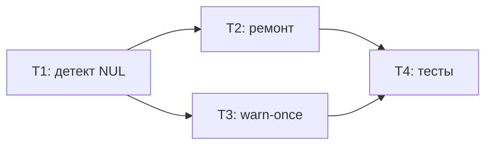

# Tasks: 013 — Ремонт history-файла с NUL-повреждением и молчаливое восстановление схемы

> Requirements: @requirements.md
> Design: @design.md
> Status: Draft
> Last Updated: 2026-10-24

## Requirement Coverage

| Requirement | Tasks | Notes |
|-------------|-------|-------|
| FR-001 | T2 | Разовый ремонт выполняется механизмом FR-002 (TD-001) |
| FR-002 | T1, T2 | Детект + молчаливый ремонт в ensureSchemaLocked |
| FR-003 | T3 | Warn-once для иностранного заголовка |
| FR-004 | T2 | Идемпотентность/атомарность — свойство алгоритма ремонта |
| NFR-001 | T2 | Strip + одна запись tmp, без построчного разбора |
| NFR-002 | T2 | finally-unlink tmp, passive observer |
| NFR-003 | T2 | Ремонт молчит |

## Design Coverage Check

| Requirement | Design Coverage | Status | Notes |
|-------------|-----------------|--------|-------|
| FR-001 | design.md §4, TD-001 | Pass | Без отдельного скрипта |
| FR-002 | design.md §4, TD-002 | Pass | Байтовый детект на Buffer |
| FR-003 | design.md §4, TD-003 | Pass | Флаг + сброс в setPaths/resetPaths |
| FR-004 | design.md §4, §8 | Pass | tmp+renameSync, идемпотентность |
| NFR-001/002/003 | design.md §4, §12 | Pass | — |

## Implementation Readiness Check

| Check | Status | Notes |
|-------|--------|-------|
| Must Have requirements have tasks | Pass | FR-001…004 покрыты |
| Tasks map to requirements, NFRs, design decisions, or enabling work | Pass | — |
| Critical Questions in requirements.md are answered | Pass | Q-001, Q-002 answered |
| Tasks have dependencies, acceptance criteria, files, and verification | Pass | — |
| Verification commands are identified or marked manual/N/A | Pass | tsx-тест + ручная проверка реального файла |
| No blocking design or requirements gaps remain | Pass | — |

## Implementation Slices

### MVP Slice

- **Goal:** NUL-повреждение чинится молчаливо при первом append; warning без спама.
- **User Stories:** US-001, US-002
- **Tasks:** T1, T2, T3
- **Independent validation:** тест-сьют + ручная проверка реального файла после первого append.

## Task Summary

| Task | Title | Priority | Estimate | Dependencies | Status |
|------|-------|----------|----------|--------------|--------|
| T1 | Байтовый детект NUL в ensureSchemaLocked | P0 | 30m | none | pending |
| T2 | Молчаливый ремонт NUL-префикса (repairNulPrefixLocked) | P0 | 1h | T1 | pending |
| T3 | Warn-once для иностранного заголовка | P1 | 30m | T1 | pending |
| T4 | Тесты: NUL-repair и warn-once кейсы | P0 | 1h | T2, T3 | pending |

## Dependency Diagram

## Task T1: Байтовый детект NUL в ensureSchemaLocked

**Priority:** P0  
**Estimate:** 30m  
**Dependencies:** none  
**Covers:** FR-002 (детект), TD-002  
**Status:** pending

### Overview

Перевести чтение файла в `ensureSchemaLocked` со строкового на Buffer и добавить байтовый детект NUL в первой строке, не меняя поведение существующих веток (create/HEADER/LEGACY/foreign).

### Work

- [ ] `readFileSync(historyFile)` без кодировки → Buffer; декодировать `toString("utf8")` один раз и переиспользовать во всех ветках.
- [ ] Детект: в байтах до первого `\n` есть `0x00` (или файл без `\n`, но `buf[0] === 0`) → ветка повреждения (заглушка → T2).
- [ ] Порядок веток: NUL → HEADER → LEGACY → foreign (design §4).

### Acceptance Criteria

- [ ] Поведение для файлов без NUL идентично текущему: все существующие тесты проходят без правок.

### Files

- `src/history.ts` — modify; чтение и детект в `ensureSchemaLocked`.

### Verification

- [ ] Существующий тест-сьют зелёный: `.\node_modules\.bin\tsx.cmd tests/history.test.mts`

## Task T2: Молчаливый ремонт NUL-префикса (repairNulPrefixLocked)

**Priority:** P0  
**Estimate:** 1h  
**Dependencies:** T1  
**Covers:** FR-001, FR-002, FR-004, NFR-001/002/003  
**Status:** pending

### Overview

Приватная функция `repairNulPrefixLocked(buf)`: strip ведущего NUL-блока, восстановление заголовка, атомарная запись. Выполняет и разовый ремонт реального 7-МБ файла (TD-001 — отдельный скрипт не создаётся).

### Work

- [ ] Найти offset первого ненулевого байта; остаток декодировать UTF-8; срезать уцелевший BOM.
- [ ] Если первая строка остатка всё ещё содержит `\x00` — отбросить её (design §4 п.4).
- [ ] EOL по содержимому остатка (`\r\n` → CRLF, иначе LF).
- [ ] Запись: tmp = `<file>.tmp.<pid>` → `writeFileSync(tmp, BOM+HEADER+eol+rest)` → `renameSync` → finally-unlink tmp.
- [ ] Вся функция в try/catch: сбой = `console.warn("pi-billing-window: history NUL repair failed:", err)` + return без записи.
- [ ] После ремонта — return (текущий append допишет строку в починенный файл). Без console.warn при успехе.

### Acceptance Criteria

- [ ] Файл с ведущими NUL после первого `appendHistory` начинается с `\uFEFF`+HEADER+EOL, NUL-байтов нет, строки данных байт-в-байт.
- [ ] Повторный append — no-op заголовка (идемпотентность).
- [ ] CRLF-файл остаётся равномерно CRLF; файл целиком из NUL → BOM+HEADER+EOL.
- [ ] Сбой rename (read-only) → append false, оригинал нетронут, orphan-tmp нет.

### Files

- `src/history.ts` — modify; новая приватная `repairNulPrefixLocked` + вызов из `ensureSchemaLocked`.

### Verification

- [ ] Тест-сьют зелёный (кейсы NUL добавляются в T4): `.\node_modules\.bin\tsx.cmd tests/history.test.mts`

## Task T3: Warn-once для иностранного заголовка

**Priority:** P1  
**Estimate:** 30m  
**Dependencies:** T1  
**Covers:** FR-003, TD-003  
**Status:** pending

### Overview

Ветка иностранного заголовка (не HEADER, не LEGACY, без NUL) сохраняет файл нетронутым, но предупреждает не чаще одного раза на процесс.

### Work

- [ ] Модульный флаг `let warnedForeignHeader = false`; проверка/установка в ветке foreign под lock; существующий текст warning сохранить.
- [ ] Сброс флага в `setPaths()` и `resetPaths()` (для тестов с несколькими файлами, design FAQ).

### Acceptance Criteria

- [ ] Три последовательных append к файлу с чужим заголовком → ровно один warning, файл не изменён (кроме аппенда строк).

### Files

- `src/history.ts` — modify; флаг, ветка foreign, setPaths/resetPaths.

### Verification

- [ ] Тест-сьют зелёный (кейсы warn-once в T4): `.\node_modules\.bin\tsx.cmd tests/history.test.mts`

## Task T4: Тесты — NUL-repair и warn-once кейсы

**Priority:** P0  
**Estimate:** 1h  
**Dependencies:** T2, T3  
**Covers:** FR-001…004 (верификация), US-001, US-002  
**Status:** pending

### Overview

Расширить `tests/history.test.mts` новыми кейсами; все существующие кейсы остаются без изменений как регресс.

### Work

- [ ] Перехват `console.warn` (заменой метода на время кейса) для подсчёта warning.
- [ ] Кейс: ведущие NUL (LF) + строки данных → починен молча: BOM+HEADER, нет NUL, данные байт-в-байт, warning 0.
- [ ] Кейс: ведущие NUL в CRLF-файле → равномерно CRLF.
- [ ] Кейс: файл целиком из NUL → BOM+HEADER+EOL.
- [ ] Кейс: идемпотентность — второй append не меняет заголовок.
- [ ] Кейс: иностранный заголовок без NUL → warning ровно 1 раз на 3 append, файл не тронут.
- [ ] Кейс: NUL-файл + read-only destination → append false, оригинал нетронут, orphan-tmp нет.
- [ ] Регресс: полный прогон всех существующих кейсов.

### Acceptance Criteria

- [ ] Все новые и существующие assert-ы проходят (`fail === 0`).

### Files

- `tests/history.test.mts` — modify; новые кейсы после блока foreign-header.

### Verification

- [ ] `.\node_modules\.bin\tsx.cmd tests/history.test.mts` → `0 failed`
- [ ] Ручная проверка (после деплоя): реальный `~/.pi/agent/pi-billing-window-history.csv` без NUL, начинается с BOM+HEADER, строки с 2026-10-14 на месте.

## Completion Rules

- Do not mark a task complete without implementation and verification evidence.
- Tests and verification belong inside each implementation task (T4 концентрирует новые кейсы).
- If a task reveals a requirements or design gap, stop and update the relevant artifact through the proper gate.
